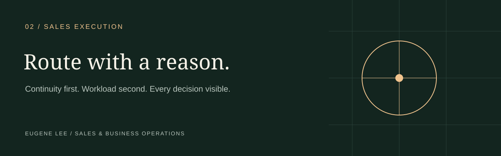
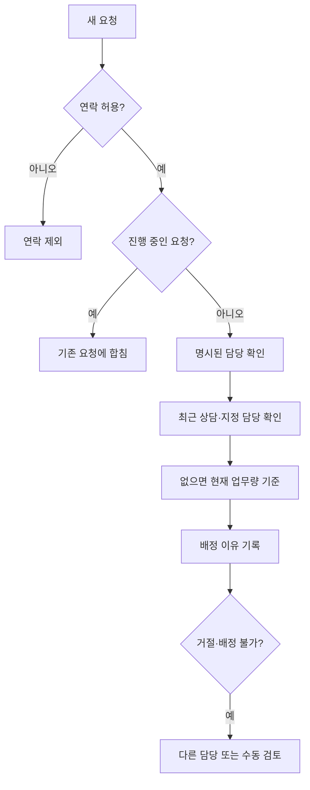

# Customer Routing Engine
### 고객을 똑같이 나누는 것과, 잘 응대할 사람에게 연결하는 것은 다르다.

[전체 프로젝트](https://github.com/leeyjn) · [개인 포트폴리오](https://leeyjn.github.io/) · [공개 범위](PUBLICATION.md)

**Sales operations · Ownership · Exception handling**

## 출발한 문제
문의가 들어오면 누구에게 맡길지 정해야 합니다. 균등 분배만 하면 이미 고객을 잘 아는 담당자를 지나칠 수 있고, 기존 담당만 고집하면 부재·거절 상황에서 일이 멈춥니다. 같은 문의가 다시 등록되면 중복 일정과 중복 연락도 생깁니다.

핵심 질문은 **‘누구에게 배정할까’에서 ‘왜 그 사람이며, 맡을 수 없을 때는 어떻게 이어갈까’**로 바뀝니다.

## 실제 산출물에서 확인한 판단
- 통합 상담 이력의 최근 담당을 우선 확인해 고객 맥락을 이어갑니다.
- 사람이 명시한 담당과 기존 미완료 요청을 별도로 처리합니다.
- 기존 관계가 없으면 현재 업무량을 고려합니다.
- 일정 초대 거절 시 다른 담당자로 재배정하는 경로를 둡니다.
- 상담 기록·답장 등의 증거로 후속 행동을 확인하도록 설계했습니다. 다만 기록 생성이 좋은 응대 품질을 보장하지는 않습니다.



## 실행
```sh
python routing.py
python -m unittest discover -s tests -v
```

가상 예제에서는 더 바쁜 담당자라도 최근 고객 맥락이 있으면 우선 연결합니다. 재배정·중복 요청·연락 거부·담당자 부재도 테스트합니다.

## 선택의 대가
업무량만 최소화하면 기존 관계를 깨뜨릴 수 있습니다. 반대로 기존 담당 우선은 업무 불균형을 만들 수 있습니다. 따라서 배정 이유를 남기고 예외를 사람이 검토할 수 있어야 합니다. 향후 개선 후보는 담당자별 실제 처리 시간, 장기 부재, 반복 재배정 횟수를 반영하는 것입니다. 이 개선 후보를 이미 운영 중인 기능으로 주장하지 않습니다.

## 실제 경험과 공개 예제의 경계
운영 원본은 Apps Script·Sheets·캘린더·메신저를 연결합니다. 여기서는 외부 연결 없이 판단 규칙만 재구성했습니다. 연락 제외는 실제 별도 파이프라인의 원칙을 공개 예제의 첫 단계로 통합했습니다. 중복 요청을 찾는 데이터 조회, 분산 잠금, 시간대 해석, 자동 완료 판정은 구현하지 않았습니다.

팀 운영과 시스템 개선을 함께 고민한 경험을 보여주는 사례이며, 배정 자동화만으로 전환율이 올랐다는 인과 효과는 주장하지 않습니다.
